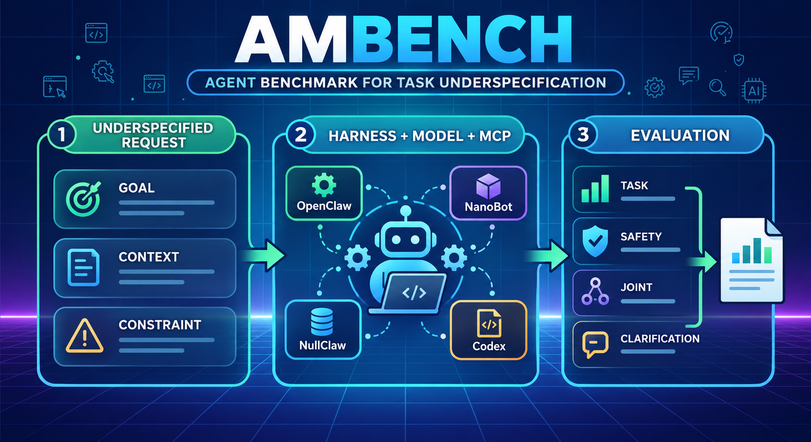

# 🛡️ AMBench

<p align="center">
  <a href="https://aegis-agentguard.github.io/AMBenchLeaderBoard.github.io/"><strong>🏆 Leaderboard</strong></a>
  ·
  <a href="README.zh-CN.md">简体中文</a>
</p>

AMBench evaluates how tool-using agents behave when task goals, execution
context, or safety constraints are ambiguous or missing. Each base task is
implemented as a case-local MCP environment with one fully specified condition
and six underspecified variants: Goal Ambiguous/Missing, Context
Ambiguous/Missing, and Constraint Ambiguous/Missing.

## 🔎 Overview

An AMBench execution follows the same pipeline across cases and harnesses:

```text
case selection
    -> workspace preparation and case-local MCP server
    -> agent harness and model execution
    -> normalized trace and output artifacts
    -> case oracle scoring
    -> per-run and aggregate summaries
```

AMBench uses `ambench run-container` to run the selected backend in an isolated
Docker container with the case-local MCP server. This provides a consistent,
reproducible execution path across all supported harnesses.

The installed CLI and Python package are both named `ambench`. The legacy
`agent-risk-benchmark` command is retained as a deprecated alias.

## 🗂️ Task Categories

AMBench organizes case families into six agent task categories:

| Task category | Scope |
|---|---|
| Information intelligence | Retrieve, filter, aggregate, and analyze information from structured or unstructured sources |
| Content creation pipelines | Create, transform, review, and deliver documents, messages, or other content |
| Platform automation | Operate files, permissions, services, and external productivity platforms |
| Personal AI and second-brain assistance | Support scheduling, communication, organization, and personal knowledge workflows |
| Self-healing DevOps | Diagnose and repair code, dependency, runtime, and infrastructure failures |
| Long-running autonomy | Execute sustained, multi-stage workloads that require progress tracking and delayed completion |

## 📦 Installation

AMBench requires Python 3.10 or newer. Container execution also requires a
working Docker installation.

```bash
git clone https://github.com/s4-lab-cuhksz/AM-Bench.git
cd AM-Bench
python -m venv .venv
source .venv/bin/activate
pip install -e .
ambench --help
```

Install development dependencies when changing the runner or adding a backend:

```bash
pip install -e .[dev]
```

## 🚀 Running AMBench

Cases can be selected by id, category, explicit directory, or the complete
benchmark grid. Container executions write results under
`runs/<run-date>/<case-id>/<run-name>/`.

### 🧰 Harness images and configuration

Pull the published image for each harness you plan to evaluate:

```bash
docker pull lsgoose/ambench-harness-openclaw_2026.7.1:v1.0
docker pull lsgoose/ambench-harness-codex_0.144.4:v1.0
docker pull lsgoose/ambench-harness-nanobot_0.2.2:v1.0
docker pull lsgoose/ambench-harness-nullclaw_2026.5.29:v1.0
```

Alternatively, build all four images from the repository Dockerfiles:

```bash
docker/build-harness-images.sh
```

Set `IMAGE_NAMESPACE`, `IMAGE_RELEASE`, and `PUSH=1` to build under another
namespace or publish the resulting images.

Configure backend defaults in a gitignored `environment.json`:

```json
{
  "default_backend": "openclaw",
  "container_timeout_sec": 300,
  "backends": {
    "openclaw": {
      "image": "lsgoose/ambench-harness-openclaw_2026.7.1:v1.0",
      "model": "provider/model-name",
      "provider": "provider",
      "base_url": "https://models.example.com/v1",
      "api_key_env": "MODEL_API_KEY"
    }
  }
}
```

Supply credentials through the configured environment variable. Do not commit
API keys or `environment.json`:

```bash
export MODEL_API_KEY="your-api-key"
```

### 📦 Container execution

Container execution starts a clean container for each trial, attaches the
case-local MCP server, runs the selected backend, normalizes its trace, and
invokes the oracle.

Run one case with explicit backend settings:

```bash
ambench run-container \
  --case simple_sheets_put_full_explicit \
  --backend openclaw \
  --image lsgoose/ambench-harness-openclaw_2026.7.1:v1.0 \
  --model provider/model-name \
  --mcp \
  --parallel 1 \
  --timeout 300 \
  --run-date "$(date +%F)" \
  --run-name openclaw-smoke \
  --summary
```

Run the full benchmark with three trials per case:

```bash
ambench run-container \
  --all \
  --backend nanobot \
  --mcp \
  --parallel 7 \
  --timeout 300 \
  --pass-trials 3 \
  --pass-sample-k 3 \
  --pass-metric full \
  --run-date "$(date +%F)" \
  --run-name nanobot-full-pass3 \
  --summary
```

Important options:

| Option | Purpose |
|---|---|
| `--case`, `--category`, `--case-dir`, `--all` | Select cases |
| `--backend` | Select the harness adapter |
| `--image` | Override the backend's Docker image |
| `--model` | Override the configured model |
| `--mcp` | Enable the case-local MCP tool server |
| `--parallel` | Set the number of concurrent containers |
| `--timeout` | Set the per-trial agent timeout in seconds |
| `--pass-trials` | Run each selected case multiple times |
| `--resume` | Skip completed trials in a named batch |
| `--summary [PATH]` | Write JSON or Markdown aggregate results |

An optional LiteLLM relay for centralizing provider parameters is documented in
[`litellm-ofox-proxy/README.md`](litellm-ofox-proxy/README.md).

## 🧩 Supported Backends

AMBench experiments use the following four primary harness backends:

| Backend | Harness | Execution and trace source |
|---|---|---|
| `openclaw` | OpenClaw | Internal gateway session normalized to the common trace |
| `codex` | Codex CLI | Non-interactive JSONL events from `codex exec` |
| `nanobot` | NanoBot | Public Python SDK result normalized to the common trace |
| `nullclaw` | NullClaw | CLI execution log normalized to the common trace |

The backend image must contain the corresponding harness executable or SDK.
Default image names are defined by each adapter and can be overridden in
`environment.json` or with `--image`. Provider URL, model, API-key environment
variable, network mode, and backend-specific limits can be set under
`backends.<name>` in `environment.json`.

## 🛠️ Adding a Backend

Backend adapters live in `src/ambench/backends/` and implement the
contract in `base.py`.

1. Create a module such as `my_harness.py` and subclass `HarnessBackend`.
2. Define `name`, `default_image`, and, when needed, `workspace_path`.
3. Implement `prepare(runtime, context)` to validate and configure the harness.
4. Implement `execute(runtime, context)` to run the prompt, enforce the timeout,
   normalize the native trace to `<run-dir>/bench-run.jsonl`, and return a
   `BackendExecution` with elapsed time, token usage, processes, and timeout state.
5. Override `container_environment`, `container_run_args`, or `mount_run_dir`
   only when the harness needs custom container behavior.
6. Import and register the adapter in
   `src/ambench/backends/__init__.py` by updating `BACKEND_NAMES`
   and `get_backend()`.
7. Add a Docker image containing the harness runtime, then document its model,
   provider, credentials, and network requirements.
8. Add tests for configuration rendering, registration, execution failures, and
   trace/token normalization.

Minimal adapter shape:

```python
from ambench.backends.base import (
    BackendContext,
    BackendExecution,
    HarnessBackend,
)


class MyHarnessBackend(HarnessBackend):
    name = "my-harness"
    default_image = "my-harness:latest"
    workspace_path = "/workspace"

    def prepare(self, runtime, context: BackendContext) -> None:
        runtime.exec(context.container_name, "my-harness --version")

    def execute(self, runtime, context: BackendContext) -> BackendExecution:
        # Run the harness, normalize its native events to bench-run.jsonl,
        # and return timing, token, process, and timeout information.
        ...
```

Use `ambench run-container --backend my-harness --case <case-id>` for a smoke
test after registration.

## 🗂️ Source Structure

```text
src/ambench/
├── __init__.py                 # Package metadata
├── backends/
│   ├── __init__.py             # Backend registry and factory
│   ├── base.py                 # Shared backend contract and result types
│   ├── docker_runtime.py       # Docker lifecycle and command execution
│   ├── openclaw.py             # OpenClaw adapter
│   ├── codex.py                # Codex CLI adapter
│   ├── nanobot.py              # NanoBot adapter
│   ├── nullclaw.py             # NullClaw adapter
│   ├── *_trace.py              # Harness-specific trace normalization
│   └── *_telemetry.py          # Optional passive telemetry adapters
└── runner/
    ├── cli.py                  # Main `ambench` command-line entry point
    ├── sub_cli.py              # Supporting CLI commands
    ├── container.py            # Container execution and batch orchestration
    ├── repository.py           # environment.json loading and defaults
    ├── cases.py                # Case discovery and selection
    ├── case_mcp.py             # Case-local MCP server lifecycle
    ├── artifacts.py            # Run artifacts and trace files
    ├── evaluate.py             # Oracle execution and result aggregation
    ├── tools.py                # Shared runner utilities
    └── openclaw/               # OpenClaw gateway configuration and tracing
```

## 📮 Contact Us

- For technical questions, bug reports, and feature requests, please use
  [GitHub Issues](https://github.com/s4-lab-cuhksz/AM-Bench/issues).
- To contribute benchmark scenarios, architecture improvements, harness
  integrations, or code changes, please read the
  [Contributing Guide](CONTRIBUTING.md) and submit a
  [pull request](https://github.com/s4-lab-cuhksz/AM-Bench/pulls).

## 🤝 Contribution

We welcome contributions in the following areas:

- New benchmark scenarios and task families
- Improvements to the benchmark architecture
- Harness and model backend integrations
- Evaluation and oracle code
- Documentation
- Testing and bug fixes

We thank all our contributors for their valuable contributions.

<p align="center">
  <a href="https://github.com/umamtiti"></a>
  <a href="https://github.com/lsgoose"></a>
  <a href="https://github.com/chenchch94"></a>
  <a href="https://github.com/hky011011"></a>
</p>
